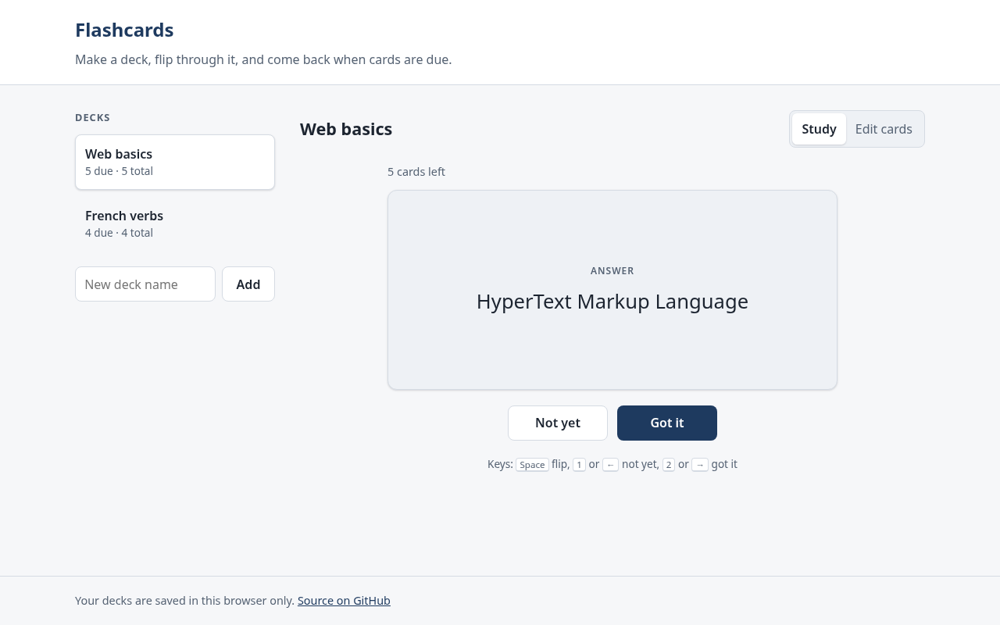

# Flashcards (Vue 3)

[](https://github.com/alexg0dev/vue-flashcards/actions/workflows/ci.yml)

A small flashcard app built with Vue 3 and Vite. You make decks, flip through the cards, and mark each one "Got it" or "Not yet". Cards you know come back less often, and cards you miss come back straight away.

**Live demo:** https://alexg0dev.github.io/vue-flashcards/



## Features

- Create, rename and delete decks
- Add, edit and delete cards
- Click or press Space to flip a card
- Simple spaced repetition (Leitner boxes, explained below)
- Keyboard shortcuts: `Space` to flip, `1` or `Left` for Not yet, `2` or `Right` for Got it
- Everything is saved in `localStorage`, so decks survive a page refresh
- Responsive layout that works on phones
- Accessible: real buttons and labelled form fields, visible focus styles, a live region for progress, and the flip animation is turned off for people who prefer reduced motion

## How the scheduling works

Each card sits in a box from 0 to 5. "Got it" moves the card up one box, and "Not yet" sends it back to box 0. The box decides how many days until the card is due again:

| Box  | 0   | 1 | 2 | 3 | 4  | 5  |
| ---- | --- | - | - | - | -- | -- |
| Days | now | 1 | 3 | 7 | 14 | 30 |

A study session shows the due cards, lowest box first. A card you mark "Not yet" goes to the back of the current session so you see it again before you finish. The logic is in [`src/lib/scheduler.js`](src/lib/scheduler.js) and has its own unit tests.

## Tech

- Vue 3 (Composition API, `<script setup>`)
- Vite
- SASS (variables, mixins and BEM-style class names)
- Vitest, Vue Test Utils and jsdom for tests
- GitHub Actions for CI and for deploying to GitHub Pages

## Project structure

```
src/
  App.vue                 layout, deck selection and tabs
  components/
    DeckList.vue          sidebar list of decks
    DeckEditor.vue        add, edit and delete cards
    StudySession.vue      the study queue and keyboard shortcuts
    FlashCard.vue         the card that flips
  composables/useDecks.js state and localStorage saving
  lib/scheduler.js        spaced repetition logic
  styles/                 SASS variables, mixins and base styles
tests/                    Vitest tests
```

## Run it locally

You need Node.js 20.19 or newer.

```bash
git clone https://github.com/alexg0dev/vue-flashcards.git
cd vue-flashcards
npm install
npm run dev
```

Then open the address Vite prints (usually http://localhost:5173/vue-flashcards/).

To make a production build:

```bash
npm run build
npm run preview
```

## Tests

```bash
npm test
```

This runs unit tests for the scheduling logic and component tests for the study session (flipping, answering, re-queuing and keyboard shortcuts). The same tests and the build run on every push in GitHub Actions.

## Licence

MIT. See [LICENSE](LICENSE).
